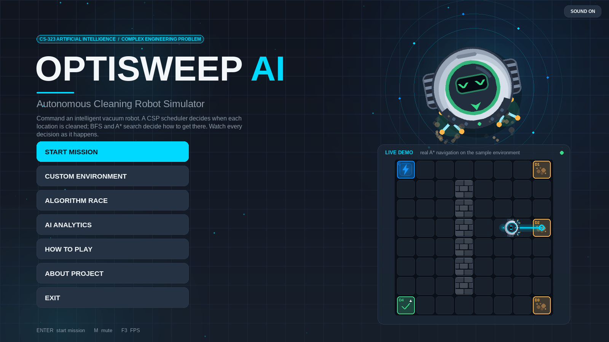
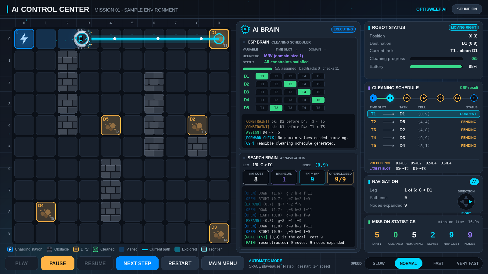
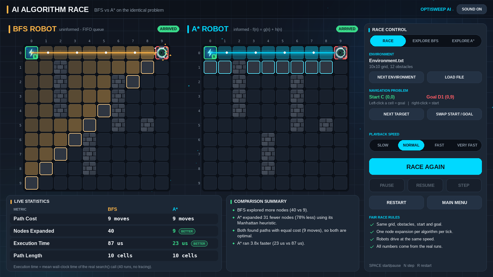

# 🤖 OptiSweep AI: Autonomous Task Scheduling & Grid Navigation


> **What happens when an autonomous robot has a list of places to visit, strict rules on *when* to visit them, and walls blocking the way?**  
> **OptiSweep AI** is a from-scratch Python simulation built to explore how classical Artificial Intelligence solves this exact problem by splitting it into two distinct "brains": a **Constraint Satisfaction (CSP) Scheduler** and a **Graph-Search Navigator**.

> 📦 **Looking for the original CLI / notebook-only version?** Check out the [original non-GUI repository](https://github.com/Dev-Rayyan-Ahmed/optisweep-ai).

---

## 🎮 The Game: OPTISWEEP AI — Autonomous Cleaning Robot Simulator

The project now ships as an interactive 2D simulation game built with **Pygame**. It runs the
*same* algorithms as the original simulation notebook and shows every decision they make.



```bash
pip install -r requirements.txt
python main.py            # add --mute to start without sound
```

| Screen | What it does |
|---|---|
| **Main Menu** | Start a mission, open the editor, the race, analytics, help and about pages. |
| **Mission Selection** | Mission 01 (sample), 02 (custom), 03 (failure test), or any other `Environment` / `Schedule` text files via the file browser. |
| **Environment Editor** | Paint obstacles, dirty locations and the charging station on an 8x8 to 16x16 grid; validate, save (original `Environment.txt` format), load, and play it. |
| **Mission Configuration** | Choose BFS or A*, Automatic or Step-by-Step, and one of four speeds; review the mission summary. |
| **AI Control Center** | The simulation: animated robot, grid, AI Brain, schedule, navigation and statistics panels, playback controls. |
| **Results** | Mission report (or failure diagnosis), constraint verification, full-journey viewer. |
| **Algorithm Race** | BFS and A* solve the identical problem side by side; also a single-algorithm exploration visualiser. |
| **AI Analytics** | Charts and a table comparing BFS and A* per navigation leg, exportable to PNG with Matplotlib. |

### Three signature features

**1. The robot.** A vector-drawn cleaning robot with a metallic shell, moving wheel treads, spinning
side brushes, a sensor bumper, an LED ring, a direction chevron and a display whose eyes change with
its state (idle, thinking, moving, cleaning, charging, error, victory).

**2. The AI Brain.** A live panel driven by events recorded from the real algorithm runs.



- *CSP Brain*: MRV selection, Degree tie-breaks, LCV ordering (with elimination counts), every
  constraint check, forward-checking prunes shown on a live domain table, backtracking.
- *Search Brain*: BFS queue operations and depths, or A* `g(n)`, `h(n)`, `f(n)` and open / closed
  list sizes, goal tests and path reconstruction. Explored and frontier cells are drawn on the grid.

**3. The Algorithm Race.** Both algorithms get the same grid, start and goal. Each tick every
algorithm expands exactly one node, so neither is artificially slowed. The statistics and the
written summary are generated from the measured results.



### Controls

| Key | Action |
|---|---|
| `SPACE` | Play / pause / resume |
| `N` or `→` | Next step (one CSP decision, one node expansion, or one robot move) |
| `R` | Restart |
| `1` `2` `3` `4` | Speed: slow, normal, fast, very fast |
| `ESC` | Back to the main menu |
| `B` | Mute / unmute background music only |
| `M` / `F3` | Mute all sound / show FPS |

In the schedule panel, click a task to inspect its coordinates, time slot and constraints. In the
race, left-click a cell to set the goal and right-click to set the start.

### How the game reuses the notebook's AI

The notebook's functions were moved, unchanged, into importable modules. The only additions are
optional `trace` callbacks: when `trace=None` (the default) the code path and return values are
exactly those of the notebook, which `tests/test_core.py` verifies by executing the notebook's own
cells and comparing results.

```text
optisweep-ai/
├── main.py                     # entry point
├── core/                       # AI logic, no GUI imports
│   ├── environment.py          # load_environment, load_schedule_constraints, validation, saving
│   ├── graph_search.py         # get_successors, goal_test, path_cost, heuristic, search (BFS / A*)
│   ├── csp_scheduler.py        # is_consistent, select_unassigned_variable (MRV + Degree),
│   │                           # order_domain_values (LCV), forward_check, backtracking_search
│   └── integration.py          # execute_schedule, plan_mission, compare_algorithms
├── gui/                        # Pygame screens and widgets (drawing only)
│   ├── app.py  ui.py  audio.py  grid_view.py  playback.py
│   ├── main_menu.py  mission_selection.py  mission_config.py  environment_editor.py
│   ├── simulation_screen.py  ai_brain.py  schedule_panel.py
│   └── algorithm_race.py  analytics_screen.py  results_screen.py
├── entities/                   # robot.py (character + animation), particles.py
├── config/settings.py          # palette, speeds, mission list
├── tests/                      # test_core.py, test_gui.py (headless end-to-end)
├── optisweep_simulation.ipynb  # original notebook, preserved for the academic submission
└── Environment*.txt  Schedule*.txt
```

Notes:

- Graphics are drawn with code and sound effects are synthesised at start-up, so there are no
  image, font or audio asset files to install. Without an audio device the game runs silently.
- The UI uses a fixed 1600x900 logical canvas. On Windows the process is marked per-monitor DPI
  aware before SDL starts (`config/dpi.py`), so the window is sized in physical pixels and the
  canvas is presented 1:1 - this keeps text sharp on 125%/150% scaled displays. Resizing the
  window preserves the 16:9 aspect ratio with letterboxing.
- Environments saved from the editor go to `environments/`. **Play this environment** also writes a
  starter `Schedule_<name>.txt` next to it (one slot per dirty location, the sample's five rules);
  edit that file or pick another schedule in Mission Selection.
- A mission is reported as completed only if the simulated robot cleaned every dirty location and
  is back on the charging station. Infeasible schedules and unreachable targets end on a failure
  screen that explains the cause.

### Tests

```bash
python -m unittest discover -s tests
```

`test_core.py` checks notebook parity, constraint satisfaction, path legality and input-error
handling. `test_gui.py` drives the real game loop headless: every menu button, all three missions
with both algorithms, step-by-step control, pause / resume / restart, the editor, the race, the
analytics export and malformed input files.

---

## 💡 Motivation: Why We Built This

When learning about autonomous agents and warehouse/service robotics, one of the coolest architectural patterns is **decoupling *what* to do from *how* to get there**:

1. **High-Level Task Planning ("In what order should I work?"):** Real-world tasks rarely happen in a random order. Certain zones have priority deadlines, while others depend on prior tasks being finished first. Trying every permutation by brute force scales terribly ($O(N!)$). We wanted to implement a **Backtracking CSP Solver** with smart heuristics to prune impossible schedules instantly.
2. **Low-Level Motion Planning ("How do I move without hitting walls?"):** Once a valid schedule exists, the agent needs to physically navigate a 2D grid from its charging dock, visit each target in the exact scheduled sequence, and return home safely. We built both **Uninformed (BFS)** and **Informed (A\*)** search engines to visualize and measure how much computation a good heuristic actually saves.

---

## 🏗️ System Architecture

The simulation operates as a two-stage pipeline driven entirely by external configuration files—no hardcoded maps or schedules:

```text
  ┌──────────────────────┐               ┌──────────────────────┐
  │     Schedule.txt     │               │   Environment.txt    │
  │ (Deadlines & Orders) │               │ (Grid, Walls, Tasks) │
  └──────────┬───────────┘               └──────────┬───────────┘
             │                                      │
             ▼                                      ▼
  ┌──────────────────────┐               ┌──────────────────────┐
  │   BRAIN 1: CSP       │               │  BRAIN 2: Navigator  │
  │  • MRV + Degree      │  Ordered      │  • A* (Manhattan)    │
  │  • LCV Ordering      │ ───────────►  │  • Breadth-First     │
  │  • Forward Checking  │  Task Queue   │  • Obstacle Avoidance│
  └──────────────────────┘               └──────────┬───────────┘
                                                    │
                                                    ▼
                                         ┌──────────────────────┐
                                         │  Simulation Engine   │
                                         │  • Full Trajectory   │
                                         │  • Cost & Node Stats │
                                         │  • 2D Grid Plots     │
                                         └──────────────────────┘
```
## 🧠 Deep Dive: How the Two Brains Work

### 1. The Scheduler (Constraint Satisfaction Problem)

Before the robot moves a single cell, it assigns every target location (`D_1, D_2, ..., D_n`) to a discrete time slot (`T_1, T_2, ..., T_m`) while obeying three strict rules:

- **Slot Exclusivity:** Only one location can be serviced per time slot.
- **Precedence Constraints:** Task `A` must be completed strictly before Task `B` (`T_A < T_B`).
- **Latest-Slot Deadlines:** Task `A` must be serviced no later than a given cutoff (`T_A <= T_max`).

To make the solver fast without guessing blindly, we implemented four classical CSP optimizations:

- **Minimum Remaining Values (MRV):** Always picks the task with the fewest legal time slots left (*fail-first* strategy).
- **Degree Heuristic (Tie-Breaker):** If two tasks have the same number of options, it picks the one involved in the most constraints with other unassigned tasks.
- **Least Constraining Value (LCV):** Tries time slots that rule out the fewest options for neighboring tasks first (*succeed-first* value ordering).
- **Forward Checking:** Immediately prunes invalid time slots from unassigned tasks after every pick. If any task runs out of options, the solver backtracks right away instead of wasting time down a dead end.

### 2. The Navigator (Graph-Based Search)

Once the CSP outputs a valid sequence (e.g., `T1: D1 → T2: D2 → T3: D3 → T4: D4`), the robot starts at the Charging Station (`C`), navigates step-by-step (`UP`, `DOWN`, `LEFT`, `RIGHT`) to each target, cleans it, and returns to `C`.

We implemented and benchmarked two algorithms side-by-side:

| Algorithm | Type | How It Thinks | Optimality | Efficiency |
|---|---|---|---|---|
| **Breadth-First Search (BFS)** | Uninformed | Explores outward in ripples, layer by layer, with zero knowledge of where the goal is. | **Optimal** when every step has equal cost | Expands many unnecessary nodes. |
| **A* Search** | Informed | Uses the heuristic `h(n)` to prioritize promising paths toward the target. | **Optimal** with an admissible heuristic and correct graph-search handling | **60%+ fewer nodes expanded** on average. |

#### Why Manhattan Distance?

Because the robot moves strictly in four cardinal directions (no diagonals), we use the **Manhattan Distance** heuristic:

$$
h(n) = |r_{current} - r_{goal}| + |c_{current} - c_{goal}|
$$

It is **admissible** (never overestimates the true cost, since obstacles can only make paths longer) and **consistent** (satisfies the triangle inequality). Therefore, A* finds the shortest path when implemented correctly, while potentially expanding fewer states than BFS.

## 📊 Visual Output & Benchmarking

Running the simulation generates:

1. **Console Telemetry:** Step-by-step constraint verification, leg-by-leg coordinates, nodes expanded, and an ASCII map of the completed run.
2. **2D Trajectory & Efficiency Plots:** Side-by-side Matplotlib visualizations showing the robot's exact path around obstacles alongside a bar chart comparing **BFS vs. A* Node Expansions** for every leg of the journey.

<!-- Optional: Add a screenshot of your generated plot below. -->
<!--  -->

## 📂 Input File Formats

You can design your own maps and scheduling puzzles by editing the plain-text configuration files.

### `Environment.txt`

```text
8,8                                         # Line 1: Grid dimensions (rows, cols)
6                                           # Line 2: Number of obstacles
(1,3), (2,3), (3,3), (4,3), (5,3), (6,3)    # Line 3: Obstacle coordinates (X)
4                                           # Line 4: Number of dirty target locations
(0,7), (3,7), (7,7), (7,0)                  # Line 5: Target coordinates (D1, D2, D3, D4)
(0,0)                                       # Line 6: Charging station coordinate (C)
```

### `Schedule.txt`

```text
4           # Line 1: Number of available time slots (T1..T4)
3           # Line 2: Number of precedence constraints
(D1,D3)     # D1 must be cleaned before D3
(D2,D4)     # D2 must be cleaned before D4
(D1,D4)     # D1 must be cleaned before D4
2           # Number of latest-slot deadlines
(D3,T3)     # D3 must be cleaned no later than T3
(D2,T3)     # D2 must be cleaned no later than T3
```

## 🚀 Getting Started

### 1. Clone the Repository

```bash
git clone https://github.com/hooria-ahmed/optisweep-ai-simulator.git
cd optisweep-ai-simulator
```

### 2. Install Dependencies

```bash
pip install -r requirements.txt
```

### 3. Play the Game

```bash
python main.py
```

### 4. (Optional) Open the Original Notebook

```bash
pip install numpy matplotlib jupyter ipywidgets
jupyter notebook optisweep_simulation.ipynb
```

The notebook is kept exactly as submitted. Running all cells regenerates the sample, custom and edge-case input files and executes the benchmark suite.

### Test Scenarios

- **Scenario 1 — Standard Benchmark:** `Environment_Sample.txt` and `Schedule_Sample.txt`. An `8 × 8` grid with a central obstacle wall.
- **Scenario 2 — Complex Map:** `Environment.txt` and `Schedule.txt`. A `10 × 10` multi-corridor map with five targets and tight scheduling deadlines.
- **Scenario 3 — Error Handling:** `Environment_Error.txt` and `Schedule_Error.txt`. Tests graceful failure detection when a schedule contains circular dependencies or a target is blocked by obstacles. The CSP fails first, so the mission ends before any movement; to watch the unreachable-target failure, load `Environment_Error.txt` with `Schedule_Sample.txt` under **Load Other Files**.

## 🛠️ Built With

- **Python 3** — Core data structures and utilities (`heapq`, `collections.deque`, `re`).
- **Pygame** — The game: rendering, animation, input and synthesised sound.
- **NumPy & Matplotlib** — Notebook plots and the game's chart export.
- **Jupyter Notebook** — Interactive execution and step-by-step analysis.

```markdown

```
-💜💙-
